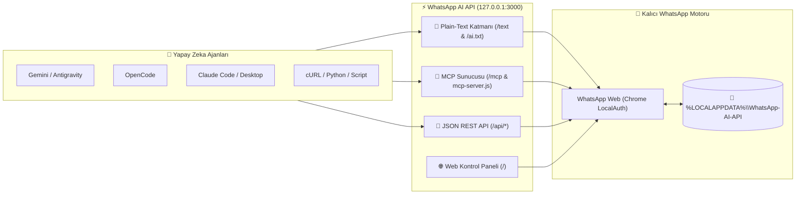

# 💬 WhatsApp AI API & MCP Bridge

<p align="center">
  
  
  
  
  
</p>

> **Gemini (Antigravity / CLI)**, **OpenCode**, **Claude Code / Claude Desktop**, **Cursor** ve diğer tüm yapay zeka ajanlarının masaüstünüzdeki **WhatsApp** hesabınızla **Düz Metin (`text/plain`)**, **Model Context Protocol (MCP)** ve **REST API** üzerinden güvenle iletişim kurmasını sağlayan yerel köprü yazılımı.

---

## ✨ Öne Çıkan Özellikler

- 🔐 **Tek Seferlik QR & Kalıcı Oturum (`LocalAuth`)**: QR kodu yalnızca bir kez okutmanız yeterlidir. Oturum verileri kod klasörüne değil, işletim sisteminizin güvenli yerel uygulama dizinine (`%LOCALAPPDATA%\WhatsApp-AI-API`) kaydedilir.
- 📝 **Plain-Text (`text/plain`) AI Backend**: Yapay zeka modelleri karmaşık JSON şemalarıyla uğraşmadan doğrudan `POST /text` adresine `"MESAJLAR Ahmet Yılmaz"` veya `"GONDER Ahmet Yılmaz | Merhaba!"` şeklinde düz metin gönderip düz metin yanıt alabilir.
- 👤 **Kişi İsmiyle Mesajlaşma & LID Çözümleyici**: WhatsApp Web'in yeni `@lid` kimliklerini gerçek telefon numaralarıyla (`@c.us`) otomatik eşleştirir. Rehberinizdeki kişilere doğrudan kayıtlı isimleriyle mesaj gönderebilir ve geçmiş mesajları okuyabilirsiniz.
- 🧠 **Tam MCP (Model Context Protocol) Desteği**: Hem `stdio` (`mcp-server.js`) hem de Streamable HTTP/SSE (`http://localhost:3000/mcp`) protokollerini destekler.
- 🛡️ **Yerel Güvenlik Mimarisi**:
  - Sunucu varsayılan olarak yalnızca `127.0.0.1` (yerel bilgisayar) adresini dinler; dış ağdan erişilemez.
  - Sıkı CORS politikası ile yalnızca `localhost` kaynaklı tarayıcı isteklerine izin verir.
  - Opsiyonel `WA_API_KEY` ortam değişkeni ile anahtar tabanlı kimlik doğrulaması sunar.
  - Kişisel oturum ve mesaj önbelleği kod dizini dışında (`%LOCALAPPDATA%\WhatsApp-AI-API`) tutulur.

---

## 🏗️ Mimari



---

## 🚀 Kurulum ve Başlatma

### 1. Bağımlılıkları Yükleyin

```bash
git clone https://github.com/ze-nox-studio/whatsapp-ai-api.git
cd whatsapp-ai-api
npm install
```

### 2. Sunucuyu Başlatın

Windows'ta **`Baslat.bat`** dosyasına çift tıklayın (veya arka planda penceresiz çalıştırmak için **`ArkaPlandaBaslat.vbs`** dosyasını açın):

```bash
npm start
```

Tarayıcınızda **[http://localhost:3000](http://localhost:3000)** adresini açın ve ekrandaki QR kodu telefonunuzdan (*WhatsApp > Ayarlar > Bağlı Cihazlar > Cihaz Bağla*) bir kez okutun.

### 3. Yapay Zeka Araçlarına Otomatik Tanıtın (Opsiyonel)

Bilgisayarınızdaki **Gemini**, **OpenCode**, **Claude Code** ve **Claude Desktop** yapılandırmalarına MCP sunucusunu tek komutla eklemek için:

```bash
npm run setup-ai
```

---

## 📝 Düz Metin (Plain-Text) AI İletişim Protokolü

Herhangi bir yapay zekaya şu talimatı (prompt) vermeniz yeterlidir:

> *"Bilgisayarımda `http://localhost:3000` adresinde WhatsApp AI API çalışıyor. Önce `http://localhost:3000/ai.txt` adresindeki düz metin kılavuzunu oku, ardından `http://localhost:3000/text` üzerinden düz metin komutlarıyla WhatsApp mesajlarımı yönet."*

### Komut Tablosu (`POST http://localhost:3000/text` veya `GET /text?cmd=...`)

| Komut | Açıklama | Örnek Kullanım |
| :--- | :--- | :--- |
| `DURUM` | Bağlantı durumunu, bağlı hesabı ve istatistikleri döndürür | `DURUM` |
| `SOHBETLER [limit] [arama]` | Son konuşulan kişileri, grupları ve son mesajları listeler | `SOHBETLER 20` veya `SOHBETLER 10 Proje` |
| `MESAJLAR <Kişi Adı veya Tel> \| [limit]` | Belirtilen kişi veya grupla olan mesaj geçmişini getirir | `MESAJLAR Ahmet Yılmaz \| 40` |
| `SON_MESAJLAR [limit]` | Tüm sohbetlerdeki son gelen/giden mesajları listeler | `SON_MESAJLAR 25` |
| `GELENLER [limit]` | Sadece karşı taraftan gelen son mesajları listeler | `GELENLER 20` |
| `GONDER <Kişi Adı veya Tel> \| <Mesaj>` | Rehberdeki kişi ismini veya numarayı bulup mesajı gönderir | `GONDER Ahmet Yılmaz \| Merhaba!` |
| `KISILER [arama]` | Rehberdeki kişileri gerçek telefon numaralarıyla (`+905...`) listeler | `KISILER Ayşe` |
| `ARA <kelime>` | Tüm mesaj geçmişinde kelime araması yapar | `ARA toplantı` |
| `SENKRONIZE` | WhatsApp Web üzerinden tüm kişileri ve geçmişi günceller | `SENKRONIZE` |
| `YARDIM` | Yapay zeka kullanım kılavuzunu düz metin olarak döndürür | `YARDIM` |

---

## 🌐 HTTP Uç Noktaları (Endpoints)

### Düz Metin (`text/plain`) Uç Noktaları
- `GET  /ai.txt` (veya `/llms.txt`) — Yapay zekalar için canlı düz metin kullanım kılavuzu
- `POST /text` — Gövdede (`text/plain`) düz metin komutu çalıştırır
- `GET  /text?cmd=...` — URL parametresiyle düz metin komutu çalıştırır
- `GET  /text/status` — Düz metin bağlantı durumu
- `GET  /text/chats?limit=25` — Düz metin son sohbetler
- `GET  /text/messages/:chat?limit=40` — Kişi adıyla veya numarayla düz metin mesaj geçmişi
- `POST /text/send` — Gövdede `Kişi Adı | Mesaj` ile düz metin mesaj gönderimi
- `GET  /text/contacts/:search` — Rehberde kişi arama
- `GET  /text/search/:query` — Mesaj geçmişinde kelime arama

### JSON REST API & MCP Uç Noktaları
- `GET  /api/status` — Bağlantı durumu ve istatistikler
- `GET  /api/chats` — Sohbet listesi (`?limit=30&search=...`)
- `GET  /api/messages` — Mesaj geçmişi (`?chatId=Ahmet%20Yılmaz&limit=40`)
- `POST /api/send` — Mesaj gönderimi (`{ "to": "Ahmet Yılmaz", "text": "Merhaba!" }`)
- `GET  /api/contacts` — Kişi listesi (`?search=Ahmet`)
- `GET  /api/search` — Mesaj arama (`?query=toplantı`)
- `POST /mcp` — Model Context Protocol (JSON-RPC 2.0) HTTP uç noktası
- `GET  /openapi.json` — OpenAPI 3.1 şeması

---

## 💻 Komut Satırı (CLI) Kullanımı

```bash
# Düz metin komutları
node wa-cli.js text "DURUM"
node wa-cli.js text "SOHBETLER 15"
node wa-cli.js text "MESAJLAR Ahmet Yılmaz"
node wa-cli.js text "GONDER Ahmet Yılmaz | Merhaba!"
node wa-cli.js text "KISILER Ayşe"
node wa-cli.js text "ARA toplantı"

# JSON çıktılı alt komutlar
node wa-cli.js status
node wa-cli.js chats 20
node wa-cli.js messages "Ahmet Yılmaz" 30
node wa-cli.js send "Ahmet Yılmaz" "Merhaba!"
```

---

## 🔒 Veri Gizliliği ve Güvenlik Yapılandırması

- **Kişisel Verilerin Konumu**: Oturum çerezleri ve mesaj önbelleği kod klasörünün içine **kaydedilmez**. Varsayılan olarak bilgisayarınızdaki kullanıcı dizinine kaydedilir:
  - **Windows**: `%LOCALAPPDATA%\WhatsApp-AI-API`
  - **macOS / Linux**: `~/.local/share/WhatsApp-AI-API`
- **Ortam Değişkenleri (Opsiyonel)**:
  - `PORT`: Sunucu portu (Varsayılan: `3000`)
  - `HOST`: Dinlenecek ağ arayüzü (Varsayılan: `127.0.0.1` — sadece yerel erişim)
  - `WA_DATA_DIR`: Kalıcı verilerin kaydedileceği özel dizin yolu
  - `WA_API_KEY`: Tanımlandığında tüm isteklerde `X-API-Key` veya `Authorization: Bearer <KEY>` başlığı zorunlu tutulur

---

## 📄 Lisans

MIT © [ze-nox-studio](https://github.com/ze-nox-studio)
